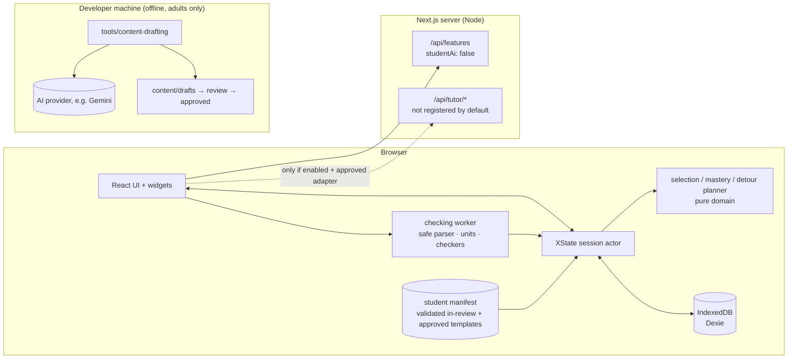

# 01 · Architecture

**Implementation status (2026-10-28):** this architecture combines the implemented Phase 1–2 foundation with later design targets. The adaptive XState engine, runtime config reader, persisted session stack, tutor providers and separate drafting package are planned. Authored hints currently run directly in the player. The [phase plan](phase-plan.md) distinguishes working features and future prompts.

## Repository inspection (Phase 0)

`~/AI/noesis` was created empty for this project. Nothing existed to preserve or migrate, so the stack was chosen fresh to satisfy the brief and the Phase 0 decisions. Phase 0 adds only documentation, curriculum data, configuration and two dependency-free check scripts. No application code is scaffolded; that is Phase 1.

## Stack

| Concern | Choice | Why |
|---|---|---|
| Framework | **Next.js** (App Router), **React**, **TypeScript** `strict` | One codebase for the browser app and any server routes (feature flags; a provider-neutral tutor contract when enabled). Runs on any Node host. |
| Package manager | npm | Already present. Avoids adding a tool. |
| Styling | Plain CSS with design tokens as custom properties (`app/globals.css`) (D-040, supersedes D-003) | The roadmap and widgets are mostly SVG and custom components; one styling system keeps tokens directly usable by SVG and canvas code. |
| UI motion | **Motion** (`motion/react`) | Layout and shared-element transitions (detour and return), spring physics for drag settle, `useReducedMotion`. |
| Simulations | Pure TypeScript models with a fixed-timestep integrator, rendered to **SVG** (default) or **Canvas 2D** (field lines, dense plots) | Deterministic models make simulations scrubbable and replayable, and unit-testable against analytic results. |
| Roadmap pan/zoom | `d3-zoom` + `d3-selection` only | Mature wheel, drag and pinch handling. Nodes stay as React-rendered SVG and HTML buttons, so they remain accessible. |
| Roadmap layout | Deterministic layered layout in `src/domain/roadmapLayout.ts` (pure, memoised, unit-tested) (D-039) | Six chapters per view need no layout engine; results are identical on every device and are checked by tests. |
| Adaptive engine (planned, Phase 4) | **XState v5** state machine over pure domain functions | Detours are recursive child actors. The machine is inspectable and every transition is testable. |
| Persistence | **IndexedDB via Dexie**, versioned schema, JSON export/import | Browser-only progress for v1 (decision U-10). Survives reloads. Supports quitting mid-detour. |
| Schemas | **Zod** for content, config, persistence records and API payloads | One schema serves build-time validation, runtime guards and route input validation. |
| Maths display | **KaTeX** | Fast, server-renderable, no layout shift. |
| Maths input | Text field with a symbol keypad and a live KaTeX "Reads as" preview (D-049, replaces MathLive) | Works with every screen reader and phone keyboard; the preview catches misreads before checking. |
| Expression parsing | Our own safe parser and closure compiler in `src/checking/expr/` (D-048, replaces Compute Engine) | Hard input limits, no code execution; equivalence by seeded multi-point sampling (docs/05). |
| Physical units | Our own unit system in `src/checking/units.ts` (D-048, replaces mathjs) | Dimension vectors, SI prefixes, compound units, °C as absolute or difference. |
| Heavy checking | Runs in a **Web Worker** (`src/checking/worker.ts`, plain `postMessage`), warmed when a question opens | Keeps parsing and sampling off the main thread. 300 ms budget; on timeout the worker restarts and the result is `indeterminate` (D-050). |
| Student AI | **None.** Authored hints run directly in the player. `src/tutor/`, `TutorProvider` and `AuthoredHintsProvider` are planned for Phase 7 | Student-facing AI stays disabled until a provider is chosen after legal review (OQ-1). No AI vendor SDK in the app. See docs/09. |
| Offline drafting (planned, Phase 7) | Separate package `tools/content-drafting/` (may use `@google/genai`) | Adult developers only; never imported by the app; outputs drafts that need human approval. |
| Tests | **Vitest** (unit), **fast-check** (property), **Playwright** (e2e, visual), **@axe-core/playwright** (a11y) | Covers pure logic, checkers, flows and accessibility. |
| Quality | `tsc --noEmit` and repository validation/test scripts are present; ESLint, Prettier and CI enforcement remain planned | Separate installed tooling from the target quality policy. |
| Fonts (self-hosted, `@fontsource-variable/instrument-sans`) | Instrument Sans for everything, with tabular numerals for readouts and stats; KaTeX fonts for maths from Phase 2 (D-041, supersedes D-022) | One family, so there are no third-party font requests and no separate monospace face. |

Versions are pinned at Phase 1 install time to the latest stable releases. The lockfile is committed.

## Module layout (Phase 2 baseline; planned entries labelled)

```
noesis/
  app/                         Next.js routes
    page.tsx                   Roadmap dashboard (Phase 1)
    chapter/[chapterId]/try/   Phase 2 demonstration lesson player; adaptive session later
    globals.css                tokens, motion tokens, all styles, reduced-motion rules
    api/features/              (later) feature flags; api/tutor/* only if student AI is enabled (docs/09)
  src/
    domain/                    PURE TypeScript, no React, no browser APIs
      curriculum.ts            Zod-validated graph access, views, prerequisite details
      roadmapLayout.ts         deterministic per-view layout + cross-view edges
      progress.ts              records, chapter/skill states, recommendations, panel stats, Leitner
      engine/                  (Phase 4) XState machines, selection, mastery, detour planner
    checking/                  worker/checkers, units and safe expression parser (Phase 2)
    content/                   schema, catalog, seeded instantiation, solvers, generated manifests
    persistence/               Dexie db + memory fallback, shared store, export/import/erase
    ui/                        roadmap/ (dashboard, map, preview, progress), player/ (lesson), motion
    widgets/<type>/            model.ts (pure) and View.tsx; shared controls/transport and registry
    tutor/                     (Phase 7) provider-neutral contract, AuthoredHintsProvider
  content/curriculum/          chapters, skills, foundations, related links (+ generated)
  content/misconceptions/, content/templates/   JSON content (Phase 2+)
  config/learning.config.json  adaptive thresholds
  scripts/                     validate-curriculum, check-contrast, check-no-ai-sdk
  tools/content-drafting/      (Phase 7) SEPARATE package: adult-only offline AI drafting; never imported by the app
  tests/unit/, tests/e2e/      Vitest and Playwright
  docs/
```

**Dependency rule:** `src/domain` and each widget's `model.ts` must not import React, the DOM, Dexie or AI code. ESLint `no-restricted-imports` enforcement is planned, not configured in the current checkout. Pure checkers and simulation models are testable in Node and reusable from the content CLI.

## Runtime data flow



- **Checking runs in the browser.** There are no accounts and no server-side scoring in v1. This is a self-study tool, so cheating is not a threat model. Running locally also means feedback is instant and the app works offline once loaded.
- **Content is static.** Only `approved` templates are bundled into production builds. The build fails if a non-approved template is referenced. See docs/05.
- **The server holds no student data.** By default the student runtime makes no AI calls at all. If student AI is ever enabled, routes are stateless and receive only the current question's context. See docs/09 and docs/10.

## Environment variables

| Variable | Where | Purpose | Default |
|---|---|---|---|
| `STUDENT_AI_ENABLED` | app server | Master switch for student-facing AI | unset = **false** |
| `STUDENT_AI_PROVIDER` | app server | Id of an installed, approved adapter | `none` |
| `GEMINI_API_KEY` | **developer shell only**, for `tools/content-drafting` | Offline drafting | unset; never set in the app's environment |

CI fails if the app's dependency tree contains an AI vendor SDK, or if the client bundle or server output contains `GEMINI_` or an AI vendor host.

## Security baseline

- Every API route validates input with Zod. Request bodies are limited to 8 KB. Responses are JSON or SSE only.
- If student AI is ever enabled, prompts are built **on the server** from the bundled content using `templateId@version` and `seed`. The client never sends prompt text. The student's own words (a typed reasoning answer or a tutor message) go in a clearly delimited user field and are capped at 1,000 characters.
- Per-IP token-bucket rate limit (in memory for development; a pluggable store for production).
- Content-Security-Policy:
  - `connect-src 'self'` only. An AI host can be added only with the feature flag plus an approved adapter, recorded in the decision log.
  - No third-party scripts and no analytics in v1.
- Expression input is never `eval`'d. Our parser builds a small AST with length, token, node and depth limits (docs/05), and evaluation compiles it to closures. There is no `eval` or `Function` anywhere in the app.
